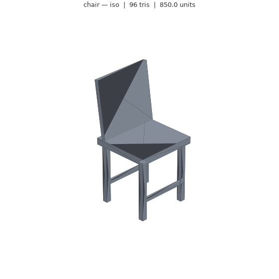

# forge3d

**A 3D-model toolchain any AI agent can drive.** One MCP server, one agent skill,
five interchangeable geometry engines, a validation layer that knows what
"correct" means for print vs web vs game, and a Three.js viewer that turns a
mesh into a single HTML file you can send to anyone.

Most "AI makes 3D" demos stop at a pretty mesh in a viewport. The hard parts are
everything after: is it watertight, is it the right size in millimetres, will it
survive a 60k-triangle budget, can the next agent pick up where this one left
off without re-reading a megabyte of vertices. forge3d is built around those.



*Nothing in that image is stock: the geometry came from `examples/procedural_chair.py`
and the render from `forge3d.render` — the same loop an agent runs.
Open `examples/chair.html` for the interactive version.*

---

## What it actually does

```
brief ──► plan_model ──► create_model ──► validate_model ──► repair_model ──► review_model
                              │                                                 │
                              ├──► previews (PNG, so the agent can *see* it)     │
                              └──► viewer (single-file Three.js page) ◄─────────┘
```

| Step | Tool | What it prevents |
|---|---|---|
| Brief | `plan_model` | generating from a vague prompt with no scale or purpose |
| Build | `create_model` | being locked into one engine |
| Inspect | `inspect_model` / `model_card` | pasting geometry into a context window |
| Check | `validate_model` | shipping a non-manifold mesh to a printer |
| Fix | `repair_model` | silent holes, flipped normals, absurd poly counts |
| Look | `render_model` | the agent guessing instead of iterating |
| Ship | `make_viewer` | needing a host to show someone the result |
| Hand off | `create_handoff` / `checklist` | two agents diverging on the same model |

## Install

```bash
git clone https://github.com/chaudharyvivek1/forge3d.git
cd forge3d
pip install -e ".[render]"
```

Optional engines — install only what you need:

```bash
# exact CSG parts (brackets, enclosures)
sudo apt install openscad          # or download from openscad.org

# organic forms, bevels, materials, animation
sudo apt install blender

# real B-rep CAD with STEP export
pip install cadquery

# decimation in repair_model
pip install fast-simplification
```

Check what this machine can actually do — never guess:

```bash
forge3d backends
```

## Quick start (agent)

Add to Claude Desktop, Cursor, or any MCP client:

```json
{
  "mcpServers": {
    "forge3d": {
      "command": "forge3d-mcp",
      "env": { "FORGE3D_WORKDIR": "/absolute/path/to/forge3d-work" }
    }
  }
}
```

For a remote agent or your own app, run it over HTTP instead:

```bash
forge3d-mcp --http 8000     # streamable HTTP on :8000
```

Then a single call gets you from brief to shareable page:

```python
create_model(
    prompt="a modern side chair with cross braces",
    name="chair",
    purpose="game",
    backend="procedural",
    source=open("examples/procedural_chair.py").read(),
    dimensions={"x": 450, "y": 480, "z": 850},
    units="mm",
    scale_to_spec=True,
)
# -> { "ok": true, "path": ".../chair.glb", "viewer": ".../chair.html",
#      "validation": { "ok": true, "summary": "PASS with 1 warning(s) ..." }, ... }
```

## Quick start (human, no agent)

```bash
forge3d plan   --prompt "wall bracket for a 32mm pipe" --purpose print --dims x=120,y=60,z=40
forge3d create --name chair --purpose game --backend procedural \
               --source examples/procedural_chair.py --dims x=450,y=480,z=850 \
               --scale-to-spec --viewer
forge3d validate output/chair.glb --profile print
forge3d render   output/chair.glb
forge3d viewer   output/chair.glb --out chair.html
```

## The five engines

| Backend | Needs | Best for | Weak at |
|---|---|---|---|
| `procedural` | nothing (trimesh) | precise dimensions, repeated structure, editable output, offline | organic forms |
| `openscad` | `openscad` binary | hard-surface CSG, brackets, enclosures, jigs | sculpting, texturing |
| `blender` | `blender` binary | bevels, subdivision, materials, rigging, animation | exact mechanical dims |
| `cadquery` | `pip install cadquery` | manufacturing, STEP deliverables, fillets | organic forms |
| `hosted` | a text-to-3D service | stylised props, characters, textured meshes fast | exact scale, watertight print geometry |

`backend="auto"` routes from the spec: `print` → OpenSCAD if present, `cad` →
CadQuery, `game` → Blender, `web` with references → hosted, otherwise
procedural. The routing table is data (`backends/registry.py`), so it is
testable and easy to change.

## Three.js

Two ways, both in the repo:

**Single-file page** — `make_viewer` embeds the GLB as a data URI, so the HTML
works offline with no server, no CORS, no hosting:

```bash
forge3d viewer output/chair.glb --out chair.html
```

**Embeddable element** — for your own app, a custom element that takes a URL:

```html
<script type="importmap">
{"imports":{"three":"https://unpkg.com/three@0.169.0/build/three.module.js",
            "three/addons/":"https://unpkg.com/three@0.169.0/examples/jsm/"}}
</script>
<script type="module" src="/forge3d-viewer.js"></script>

<forge3d-viewer src="/models/chair.glb" height="480" autorotate grid></forge3d-viewer>
```

Events: `forge3d:loaded` (`detail.triangles`), `forge3d:error`.
See `docs/threejs.md`.

## Why the context-window rules matter

A 100k-triangle GLB is a few megabytes; as text it is millions of tokens. So
every tool in forge3d takes and returns **paths**, never geometry. The one way to
describe a model in context is `model_card` — roughly 300 tokens:

```
**chair.glb** — glb
96 tris · 418.77 x 412.56 x 850 mm · watertight · 8 body
validation: PASS with 1 warning(s) — game profile (single_body)
ship as: .glb
```

## Multi-agent, multi-person

`handoff.py` defines the packet that lets a second agent — or a designer and a
3D artist — take over without re-deriving anything: spec, artifacts, checks,
owners, open questions, and who is next. It writes both JSON (for agents) and
Markdown (for humans). See `docs/multi-agent.md`.

```python
create_handoff(
    spec=spec, artifacts={"model": "chair.glb", "viewer": "chair.html"},
    backend="procedural",
    checks=checklist("game"),
    owners={"design": "priya", "geometry": "agent-a"},
    next_agent="review-agent",
)
```

## Repository layout

```
src/forge3d/
  spec.py          the brief as data — purpose, units, dimensions, budget
  backends/        procedural · openscad · blender · cadquery · hosted
  validate.py      profile-based checks, every failure carries a fix hint
  repair.py        merge, drop, fill, re-orient, decimate
  render.py        CPU previews (matplotlib) — works headless, no GPU
  viewer.py        single-file Three.js page
  viewer_assets/   template.html + forge3d-viewer.js custom element
  context.py       model cards — the only sanctioned way to describe a mesh
  handoff.py       checklists + multi-agent handoff packets
  jobs.py          durable job records for slow generations
  server.py        the MCP surface (13 tools)
  cli.py           same capabilities without an agent
skill/             agent skill: SKILL.md + references
docs/              architecture, backends, threejs, multi-agent, licensing
examples/          chair (trimesh), bracket (OpenSCAD), gear (bpy)
tests/             pytest
```

## Honest limitations

- **Textures.** The local engines produce geometry, not painted PBR materials.
  For textured output, route to a hosted text-to-3D service.
- **Hosted adapter.** Provider APIs (Meshy, Tripo, Rodin, Hunyuan3D) differ.
  `hosted.py` speaks one small documented contract — point it at a thin worker.
  It does not pretend to be a drop-in client for all of them.
- **Rigging.** Blender can rig; forge3d does not generate skeletons or weights
  for you. Auto-rig quality varies badly.
- **Preview renders** are review-quality, not beauty shots. For beauty, the
  Three.js viewer with an environment map is the better tool.
- **Licensing.** Output rights differ sharply between hosted services. That is
  your provider's terms, not this repo's. See `docs/licensing.md`.

## Licence

MIT — see `LICENSE`. Built by [Vivek Chaudhary](https://github.com/chaudharyvivek1).
